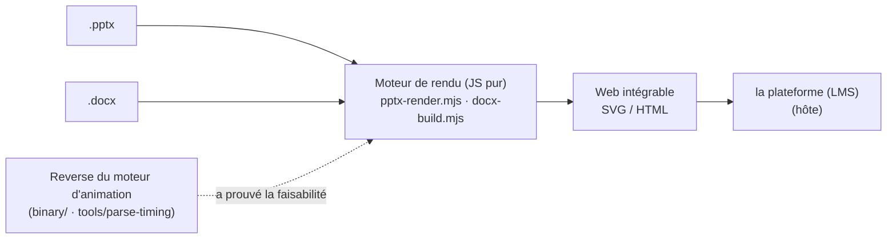
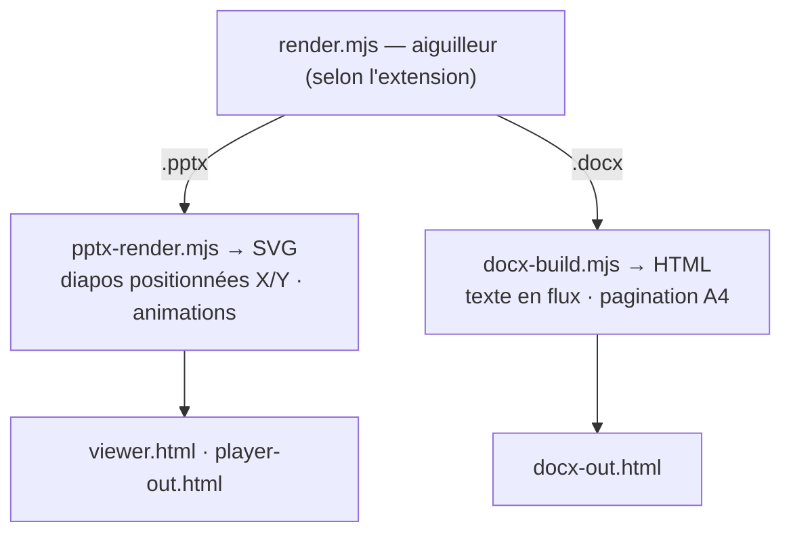
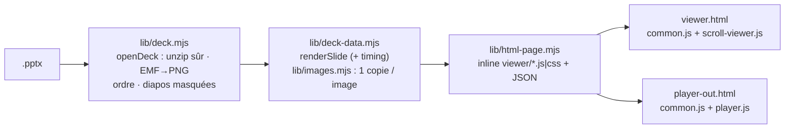
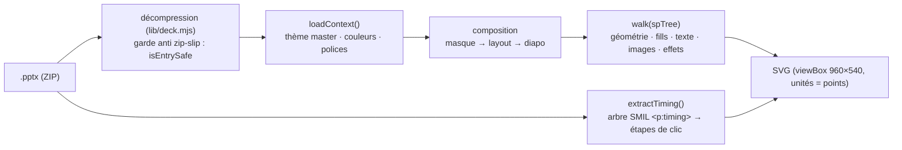
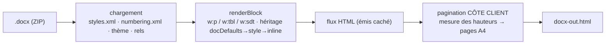

# Architecture — moteur de rendu Office → Web

> **But de ce document :** comprendre en 5 minutes *qui fait quoi* dans `renderer/`, sans avoir à lire
> le code. À jour au 2026-07-28. Point d'entrée pour tout humain **ou** machine qui reprend le projet.

## 1. C'est quoi ce dépôt ?

Un **moteur de rendu qui convertit des fichiers Office (PowerPoint `.pptx`, Word `.docx`) en Web
(HTML/SVG)**, en JavaScript pur, **sans PowerPoint ni Word installés**. Objectif : afficher les supports
de cours dans un LMS.



- **La plateforme (LMS)** = l'application hôte qui intègre ces pages Web.
- **Ce dépôt** = l'outil qui transforme les `.pptx`/`.docx` en pages Web que la plateforme peut intégrer.
- Origine : besoin d'afficher des PowerPoint **animés** sans PowerPoint. Le reverse du moteur d'animation
  (voir §7) a prouvé la faisabilité ; le moteur de rendu maison en découle.

## 2. Vue d'ensemble — qui fait quoi



Deux **moteurs indépendants** (fichiers séparés, aucune dépendance croisée) :

| | PPTX | DOCX |
|---|---|---|
| Cœur | **`pptx-render.mjs`** → SVG | **`docx-build.mjs`** → HTML |
| Modèle | PresentationML : diapos, formes **positionnées** en X/Y, animations | WordprocessingML : texte **en flux**, pagination |
| Sorties | `viewer.html`, `player-out.html` | `docx-out.html` |

Un **aiguilleur** unique `render.mjs` choisit le bon moteur selon l'extension.

## 3. Les trois modes de sortie (⚠️ la source de confusion la plus fréquente)

| Mode | Fichier / script | Ce que c'est | Quand l'utiliser |
|---|---|---|---|
| **Viewer (défilement)** | `build.mjs` → `viewer.html` | **Toutes** les diapos empilées, on **scrolle**. État *final* de chaque diapo (pas d'animation). | Relire vite un deck entier, vérifier le rendu statique. |
| **Présentation (animée)** | `build-player.mjs` → `player-out.html` | **Une** diapo à la fois, plein écran, les **animations rejouées au clic**. | Présenter comme un diaporama PowerPoint. |
| **PDF fidèle** | `office-to-pdf.mjs` → `*.pdf` | Rendu **pixel-perfect** via **LibreOffice** (vrai moteur de mise en page). | Quand le rendu HTML en flux ne suffit pas (mises en page complexes). |
| **(Word)** | `docx-build.mjs` → `docx-out.html` | Document Word en **flux paginé A4** dans le navigateur. | Afficher un `.docx` dans le LMS. |

**Règle mentale :** *viewer = scroll · player = présentation animée · office-to-pdf = fidélité maximale.*
Le viewer et le player utilisent **le même** moteur PPTX (`pptx-render.mjs`) ; ils ne diffèrent que par
l'enveloppe HTML (défilement vs plein-écran+animation).

### Anatomie des deux viewers



- **Une seule copie par image** : le SVG porte un jeton `op-img:N`, l'image est stockée une fois dans le
  JSON de la page ; `viewer/common.js` crée une URL `blob:` à la 1re utilisation (marche en `file://`).
  Deck réel de 66 diapos : ~55 Mo → ~26 Mo (le reste = les images elles-mêmes en base64).
- **Défilement** : SVG insérés à l'approche de l'écran (IntersectionObserver) ; diapos masquées affichées
  grisées (badge « masquée ») ; `#3`, j/k, barre « aller à ».
- **Présentation** : diapos masquées sautées ; l'état de la diapo après *p* clics est **calculé** puis
  appliqué d'un coup, les effets sont des Web Animations par-dessus — annuler = état final immédiat (clics
  rapides et retours arrière sûrs). Modèle détaillé en tête de `viewer/player.js`.
- Le runtime vit dans de **vrais fichiers** `renderer/viewer/*.js|css` (lintés), inlinés au build : la sortie
  reste un fichier HTML unique. Vérification navigateur : `npm run test:e2e`.

## 4. Le moteur PPTX (`pptx-render.mjs`)



`renderSlide(pptDir, n)` produit **un SVG par diapo** (viewBox 960×540, unités = points). Étapes :

1. **Décompression** du `.pptx` (fflate).
2. **`loadContext()`** — thème du *master* de la diapo (couleurs `clrScheme`, polices, `clrMap` sombre),
   styles de texte hérités.
3. **Composition** — on peint le fond puis les décorations dans l'ordre **masque → layout → diapo**.
   Les `data-spid` du masque/layout sont préfixés (`m`/`l`) pour ne pas entrer en collision avec la diapo.
4. **`walk(spTree)`** — chaque forme : géométrie (`preset-geom.mjs`), remplissage/dégradé, texte
   (`foreignObject` HTML + autofit), images (clip à la forme, `metafiles.mjs` pour EMF/WMF), effets.
5. **SVG** avec un `<defs>` (clips, dégradés, filtres, marqueurs). **Les IDs de defs sont préfixés par
   diapo** (`s<n>_clip0`…) — sinon collision quand plusieurs diapos coexistent dans une page (viewer).

**Animations** : `extractTiming()` lit l'arbre SMIL `<p:timing>` → étapes de clic (avec leur déclencheur
`click` / `withPrev` / `afterPrev` et, par effet, preset, zoom, échelle, « venir de ») ; seul le player
les rejoue. Détails : [`moteur-animation.md`](moteur-animation.md).

**Où est le code** : `pptx-render.mjs` n'est qu'une façade ; le moteur est découpé en petits modules
dans `renderer/pptx/` (XML, couleurs, thème, parts/rels, polices, géométrie, animations) et
`renderer/pptx/slide/` (composition, parcours, formes, images, cadres, texte, peinture, effets). Carte
complète et règles : [`../AGENTS.md`](../AGENTS.md) et l'en-tête de `renderer/pptx-render.mjs`.

## 5. Le moteur DOCX (`docx-build.mjs`)



`renderDocx(path)` produit **un HTML paginé A4**. Modèle **en flux** (le texte coule), contrairement au
PPTX. Points clés :

- **Chargement** : `styles.xml` + `docDefaults`, `numbering.xml` (puces), thème, `rels` (images),
  en-têtes/pieds.
- **`renderBlock`** : paragraphe (`w:p`) / tableau (`w:tbl`) / `w:sdt` (table des matières…). Les runs
  héritent leurs propriétés dans l'ordre **docDefaults → style du paragraphe → inline**.
- **Pagination CÔTE CLIENT** : le flux est émis caché, puis un script **mesure les hauteurs réelles** et
  découpe en pages A4 uniformes (ce qu'un rendu serveur ne peut pas faire), en respectant les frontières
  de page de Word (`lastRenderedPageBreak`).
- **Géré** : interligne, espacement, indentation, tailles, **titres**, puces (Wingdings→Unicode),
  **tableaux** (largeurs de colonnes), **table des matières** (points de suite + n°), **en-têtes/pieds**
  (Page X sur Y), suivi de modifications, images.
- **Limite dure** : le **collage de page de garde** (images flottantes en position absolue) et la
  recoloration d'image ne sont pas reproductibles en flux → utiliser `office-to-pdf.mjs`.

## 6. Référence fichier par fichier (`renderer/`)

| Fichier | Rôle | Sortie |
|---|---|---|
| **`pptx-render.mjs`** | **Cœur PPTX** : `renderSlide`, `loadContext`, `extractTiming`. Ne pas casser. | SVG (string) |
| `build.mjs` | Viewer : rend toutes les diapos d'un `.pptx` en défilement | `viewer.html` |
| `build-player.mjs` | Présentation animée (rejoue `<p:timing>` au clic) | `player-out.html` |
| `lib/deck.mjs` · `lib/deck-data.mjs` · `lib/images.mjs` · `lib/html-page.mjs` | Pièces partagées des viewers (ouverture du deck, données, images dé-dupliquées, page) — voir §3 | — |
| `viewer/*.js` · `viewer/*.css` | Runtime navigateur des viewers, inliné au build | — |
| **`docx-build.mjs`** | **Cœur DOCX** : `renderDocx` (autonome, ne touche pas le PPTX) | `docx-out.html` |
| `render.mjs` | Aiguilleur : `.pptx`→build.mjs, `.docx`→docx-build.mjs | — |
| `office-to-pdf.mjs` | Rendu fidèle via LibreOffice (docx **et** pptx) | `*.pdf` |
| `preset-geom.mjs` | Évaluateur de géométrie DrawingML (187 formes prédéfinies + guides) | — (support PPTX) |
| `metafiles.mjs` + `convert-metafiles.ps1` | Convertit EMF/WMF → PNG (.NET/WIC, Windows) | `*.png` |
| `gen-preset-shapes.mjs` | Génère `preset-shapes.json` depuis la spec (outil ponctuel) | JSON |
| `check.mjs` | QA PPTX batch : rend chaque diapo, compte erreurs + diapos « maigres » | console |
| `docx-check.mjs` | QA DOCX batch : rend chaque `.docx`, crash + métriques texte/img/tbl | console |
| `sweep.mjs` / `sweep-all.mjs` | Diff **pixel** vs réf PowerPoint (oracle COM), rapport trié | JSON + PNG |
| `compare.mjs` | Diff de deux images (localise les écarts par grille) | console + PNG |
| `scan.mjs` | Inventaire des fonctionnalités DrawingML utilisées par le corpus | console |

## 7. Pour aller plus loin

- **Fidélité de police / texte** : [`police-fidelite-suite.md`](police-fidelite-suite.md) — journal détaillé
  des correctifs (interligne autofit, symboles, clipping, etc.).
- **Base de connaissances OOXML** : [`ooxml/`](ooxml/) — carte de la spec, matrice de couverture
  (élément → statut → code), pièges (EMU/points, clrMap sombre, trimValues…).
- **Reverse du moteur d'animation** (origine du dépôt) :
  [`synthese-globale.md`](synthese-globale.md), [`moteur-animation.md`](moteur-animation.md),
  [`binaire-ppcore.md`](binaire-ppcore.md), [`dynamique-runtime.md`](dynamique-runtime.md).
- **Comparaison / oracle** : [`compare-workflow.md`](compare-workflow.md).

## 8. Démarrage rapide

```bash
npm install
npm test                                           # tests unitaires (node:test) des fonctions PURES

# Un fichier, le bon moteur automatiquement :
node renderer/render.mjs "chemin/deck.pptx"        # -> renderer/viewer.html
node renderer/render.mjs "chemin/doc.docx"         # -> renderer/docx-out.html

# Explicitement :
node renderer/build.mjs        "deck.pptx"         # viewer (défilement)
node renderer/build-player.mjs "deck.pptx"         # présentation animée
node renderer/office-to-pdf.mjs "doc.docx"         # PDF fidèle (LibreOffice)

# Contrôle qualité (aucune erreur attendue) :
node renderer/check.mjs      "specimen/sample"     # tous les .pptx d'un dossier
node renderer/docx-check.mjs "specimen"            # tous les .docx d'un dossier
```

## 9. Règles d'or (pour ne rien casser)

1. **Le moteur PPTX (`renderer/pptx/`) est le cœur** : toute modif se vérifie avec `npm test`, `npm run lint`,
   `npm run diff` (diapos modifiées vs HEAD, planche avant/après) et `npm run test:e2e` (les deux viewers).
   Sur un corpus local, `check.mjs` doit rester à **0 erreur**.
2. Les **moteurs sont séparés** : toucher `docx-build.mjs` ne peut pas casser le PPTX (et inversement).
3. Les decks d'exemple (`test/fixtures/decks.mjs`) couvrent animations, formes, texte, tableaux et
   graphiques : toute correction y ajoute un cas.
4. Piège récurrent : tout **ID SVG interne** (`url(#…)`) doit être unique par diapo (préfixe `s<n>_`).
5. Anti-régression visuelle : hash SVG des diapos avant/après, ou `sweep`/`compare` contre l'oracle.
6. **Deux filets complémentaires** : `npm test` (node:test) verrouille la **logique pure** (couleurs,
   unités EMU, symboles, parsing de timeline) ; `check.mjs` + hash SVG verrouillent le **rendu**. Une
   refonte du cœur doit garder les deux au vert, et `npm run diff` doit afficher « 0 modifiée(s) ».
